# Kako radi multi-mouse

Ovaj dokument objašnjava kako multi-mouse radi, korak po korak, uz dijagrame.
Upute za instalaciju su u [README.md](../README.md), a stanje projekta i sljedeći koraci u [HANDOFF.md](../HANDOFF.md).

## 1. Problem

Windows ima **jedan kursor i jedan fokus tipkovnice** za cijeli sustav. Svaka priključena tipkovnica i svaki miš upravljaju istim kursorom. Zato dvoje ljudi ne može raditi istovremeno.

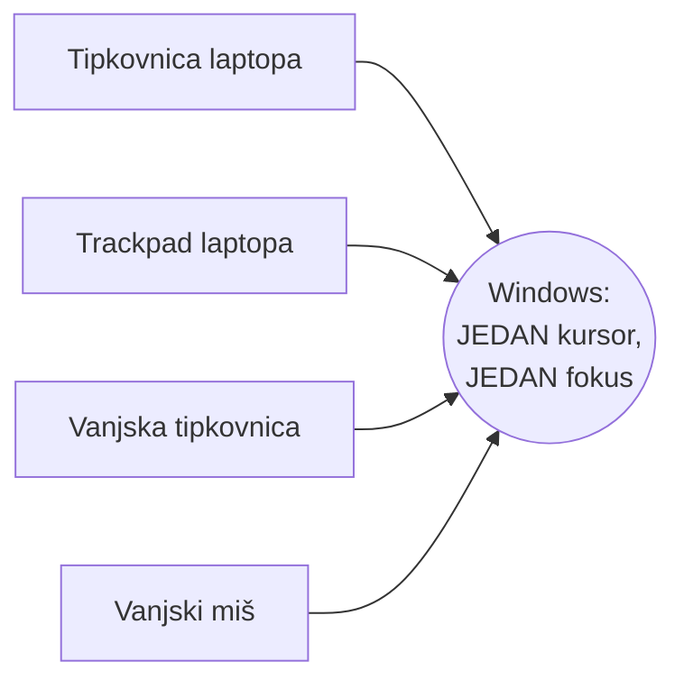

## 2. Rješenje u jednoj slici

Vanjsku periferiju **oduzmemo Windowsu** i njezine događaje šaljemo preko Tailscalea **direktno na Mac**. RustDesk služi samo za **gledanje** Mac ekrana.

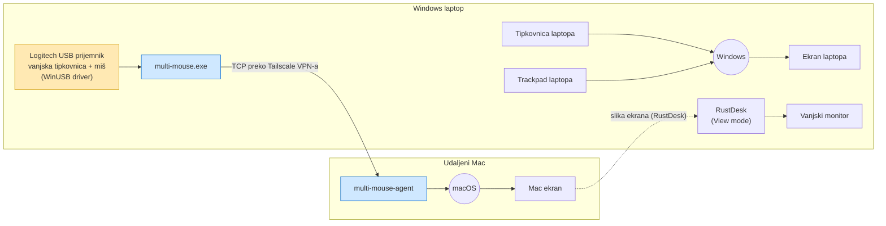

- **Osoba A** radi na Windowsu s tipkovnicom i trackpadom laptopa i ništa ne primijeti.
- **Osoba B** gleda Mac na vanjskom monitoru i upravlja njime vanjskom tipkovnicom i mišem.

## 3. Kako vanjsku periferiju "oduzmemo" Windowsu

Windows inače USB tipkovnicu i miš drži za sebe preko **HID drivera** (`HidUsb` → `kbdhid`/`mouhid`). Obične aplikacije ne smiju čitati tipkovnicu i miš direktno.

Trik: pomoću **Zadiga** na Logitech prijemnik stavimo Microsoftov **WinUSB** driver. Windows ga onda više ne vidi kao tipkovnicu i miš, a multi-mouse ga čita kao običan USB uređaj (preko libusb).

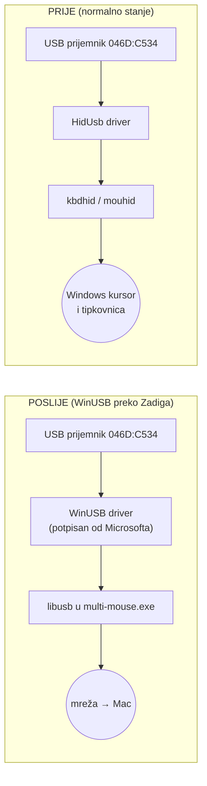

**Zašto ne Interception kernel driver?** Na ovom laptopu je uključen *Memory Integrity (HVCI)*. Interception je stari filter driver za **sve** tipkovnice i miševe. Kad bi ga HVCI blokirao, nakon restarta ne bi radila ni tipkovnica ni trackpad laptopa. WinUSB pristup dira **samo** vanjski prijemnik, ne treba restart i lako se vraća.

Logitech prijemnik ima dva USB sučelja, a WinUSB ide na oba:

| sučelje | što nosi |
|---|---|
| Interface 0 (`MI_00`) | tipkovnica |
| Interface 1 (`MI_01`) | miš, tipke za glasnoću, Logitech HID++ |

## 4. Što se događa unutar `multi-mouse.exe`

Aplikacija ima tri vrste niti (threadova) koje komuniciraju preko kanala (`mpsc`):

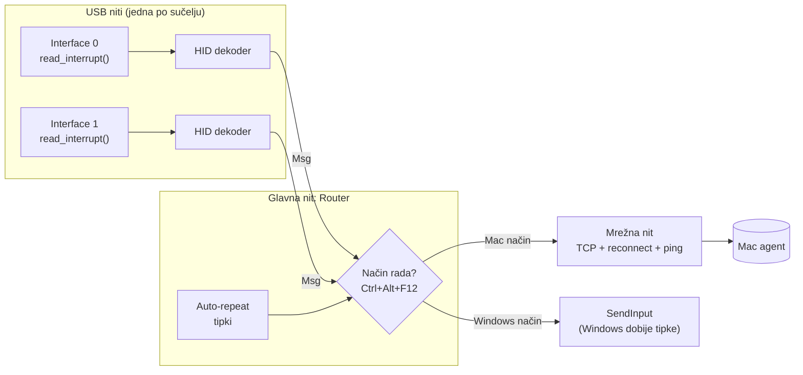

| datoteka | uloga |
|---|---|
| `usb.rs` | pronađe prijemnik, provjeri ima li WinUSB (registry), čita USB izvještaje |
| `hid.rs` | parsira **HID report descriptor**, tj. "kartu" izvještaja: gdje su tipke, X/Y, kotačić |
| `translate.rs` | usporedi novi izvještaj s prethodnim i iz razlike napravi događaje "pritisnuto"/"pušteno" |
| `usbkeys.rs` | HID kod tipke → PC scan code |
| `app.rs` | Router: Mac/Windows način, prečac, auto-repeat |
| `net.rs` | TCP veza prema Macu, spajanje pomaka miša, ping, ponovno spajanje |
| `inject.rs` | `SendInput` za Windows način |

## 5. Od pritiska tipke do slova na Macu

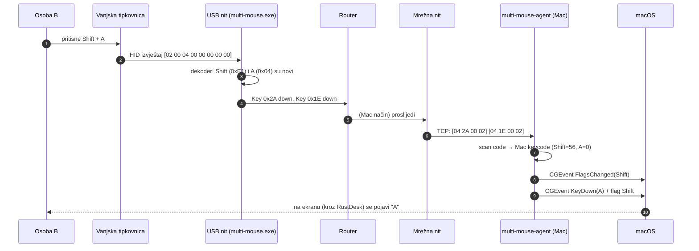

### Kako dekoder pretvara izvještaje u događaje

USB tipkovnica ne šalje "pritisnuto A", nego **snimku stanja**: popis svih trenutno pritisnutih tipki. Dekoder pamti prethodnu snimku i šalje samo razliku:

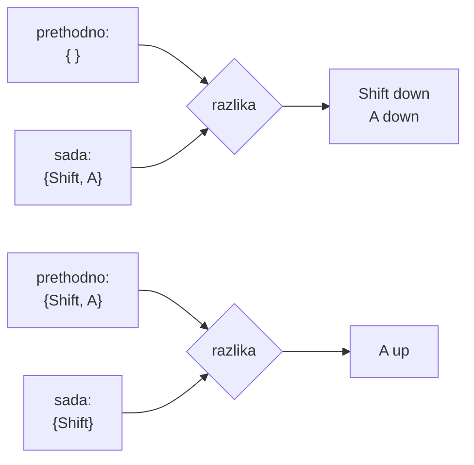

Isto vrijedi za tipke miša. Pomaci (X/Y) i kotačić su **relativni**, pa se šalju direktno.

USB tipkovnice same ne ponavljaju tipku kad je držiš. Zato Router radi **auto-repeat**: nakon 500 ms ponavlja tipku svakih 33 ms.

## 6. Prebacivanje Mac ↔ Windows (Ctrl+Alt+F12)

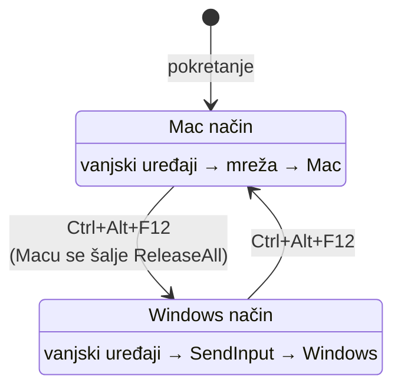

Svaki pritisak pamti **kamo je otišao**. Zato otpuštanje uvijek ide istom odredištu, čak i ako se način promijenio dok je tipka bila pritisnuta. Bez toga bi npr. Ctrl ostao "zaglavljen" na jednoj strani.

## 7. Mrežni protokol

Jednostavan binarni protokol preko TCP-a (port **47800**), opisan u `crates/proto/src/lib.rs`.

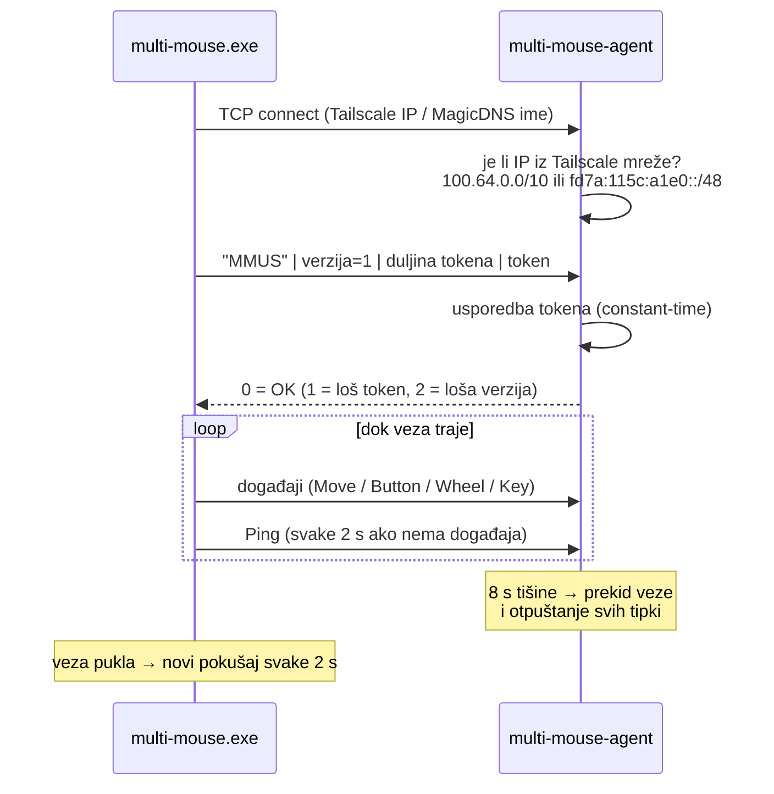

| tag | poruka | sadržaj |
|---|---|---|
| 1 | `Move` | `i32 dx`, `i32 dy` (sirovi pomak miša) |
| 2 | `Button` | gumb (lijevi/desni/srednji/natrag/naprijed), dolje/gore |
| 3 | `Wheel` | `i32 vertikalno`, `i32 horizontalno` (120 = jedan "klik") |
| 4 | `Key` | `u16 scan code`, zastavice (E0, dolje) |
| 5 | `ReleaseAll` | otpusti sve |
| 6 | `Ping` | održavanje veze |

Mrežna nit **spaja uzastopne pomake miša** u jedan paket. Miš koji šalje 1000 izvještaja u sekundi zato ne zaguši vezu.

## 8. Mac strana: `multi-mouse-agent`

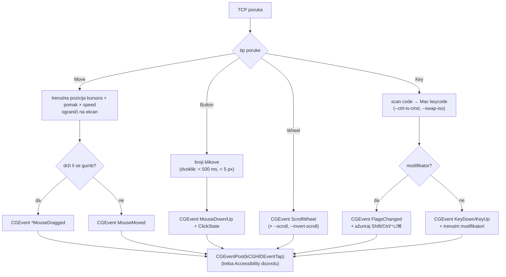

Mapiranje tipki ide po **fizičkom položaju**. Raspored (npr. hrvatski) primjenjuje Mac, isto kao kad bi tipkovnica bila spojena direktno na Mac.

| PC tipka | Mac (zadano) | s `--ctrl-is-cmd` |
|---|---|---|
| Ctrl | Control ⌃ | Command ⌘ |
| Windows | Command ⌘ | Control ⌃ |
| Alt | Option ⌥ | Option ⌥ |
| AltGr | desni Option ⌥ | desni Option ⌥ |

## 9. Sigurnost

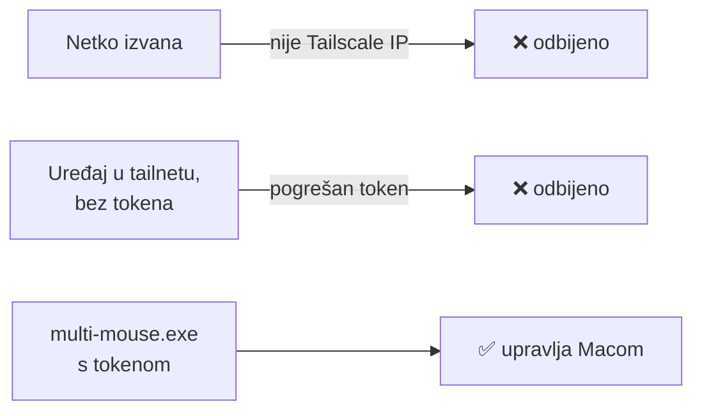

- Agent prihvaća veze **samo s Tailscale adresa**, osim ako se pokrene s `--allow-any`.
- Token (128 bita, nasumičan) je spremljen u `~/.config/multi-mouse/token` na Macu, s dozvolama `600`.
- Promet je kriptiran jer ide kroz Tailscale (WireGuard).

## 10. Otpornost na greške

| situacija | što se dogodi |
|---|---|
| vanjski prijemnik izvučen | USB nit otpusti sve tipke i svake 2 s pokušava ponovno |
| Mac nedostupan | Windows strana odbacuje događaje i svake 2 s se pokušava spojiti |
| veza pukne usred držanja tipke | Mac nakon najviše 8 s otpusti sve tipke i gumbe |
| `multi-mouse.exe` zatvoren | vanjski uređaji ne rade nigdje (WinUSB), a laptop radi normalno |
| želim prijemnik natrag na Windows | Device Manager → USB Receiver → Uninstall device (+ izbriši driver), za oba sučelja, pa izvuci i vrati prijemnik |

## 11. Postavljanje, redom

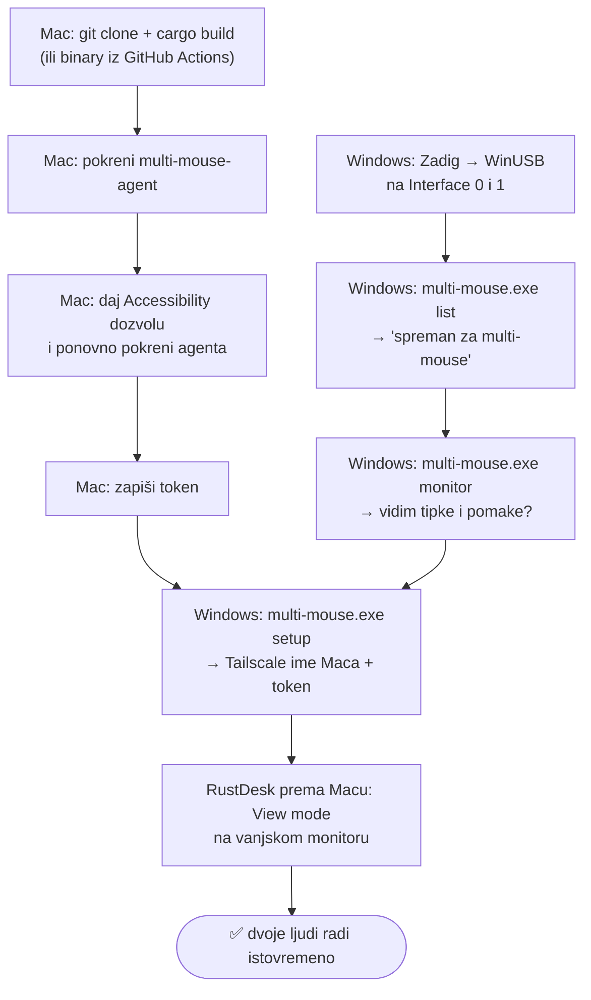
